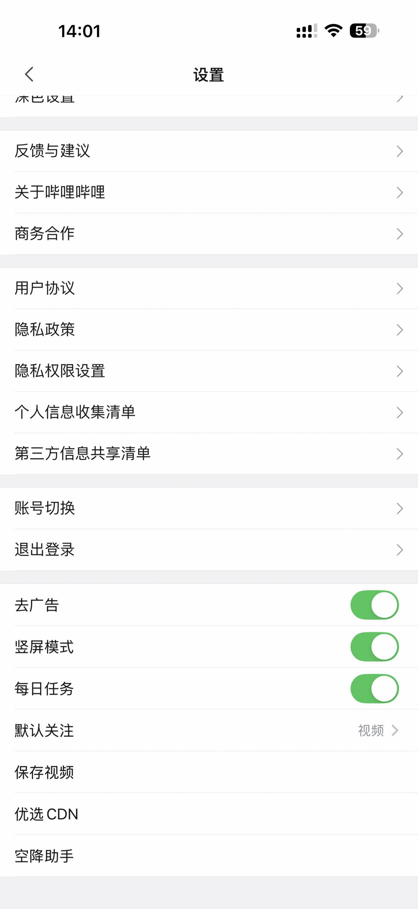

## 七项功能

七项功能统一位于「我的 → 设置」，空降助手紧跟优选 CDN。

| 功能 | 说明 |
|---|---|
| 去广告 | 去掉所有广告、开屏广告和无用功能按钮 |
| 竖屏模式 | 提供竖屏模式开关，按使用习惯配置播放体验 |
| 每日任务 | 打开 APP 自动完成每日经验任务 |
| 默认关注 | 关注页面默认只展示视频 |
| 保存视频 | 缓存视频后可保存到相册 |
| 优选 CDN | 屏蔽 PCDN，一键测速 CDN，手动选择最快 CDN |
| 空降助手 | 自动跳过赞助、推广、互动提醒、过场等内容 |

## 界面预览

<table>
  <tr>
    <th align="center">首页</th>
    <th align="center">我的</th>
    <th align="center">七项功能入口</th>
  </tr>
  <tr>
    <td align="center" valign="top"></td>
    <td align="center" valign="top"></td>
    <td align="center" valign="top"></td>
  </tr>
</table>

<table>
  <tr>
    <th align="center">优选 CDN</th>
    <th align="center">空降助手</th>
  </tr>
  <tr>
    <td align="center" valign="top"></td>
    <td align="center" valign="top"></td>
  </tr>
</table>

## 空降助手

- 总开关及最短片段时长设置。
- 可选跳过提示、进度条片段颜色和跳过次数统计跟踪。
- 显示已跳过片段数量与累计节省时间。
- 分类处理方式包括：总是跳过、跳过一次、手动跳过、仅显示和禁用。
- 分类涵盖赞助／恰饭、无偿／自我推广、独家访问／抢先体验、三连／互动提醒、精彩时刻／重点、过场／开场动画、鸣谢／结束画面、回顾／概要、填充内容／前黑／后黑、离题闲聊／玩笑、音乐中的非音乐部分。
- 整段标签和精彩时刻不会作为普通片段自动跳过；实际行为以插件设置为准。
