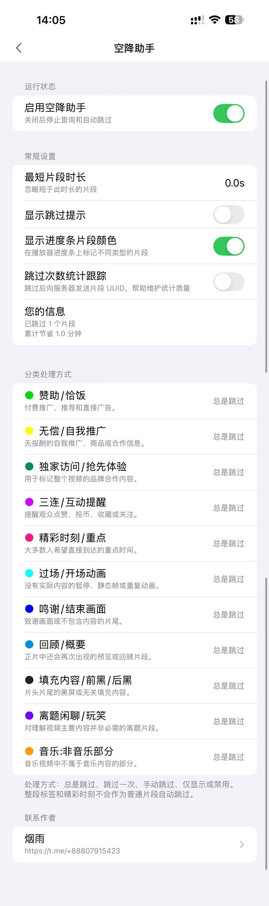

# 哔哩哔哩净化

基于哔哩哔哩 iOS 8.76.0 的定制版本，整合界面净化、播放辅助、优选 CDN 和空降助手。七项功能统一位于「我的 → 设置」，空降助手紧跟优选 CDN。

## 七项功能

| 功能 | 说明 |
|---|---|
| 去广告 | 提供广告过滤与界面净化开关，让浏览界面更简洁。 |
| 竖屏模式 | 提供竖屏模式开关，按使用习惯配置播放体验。 |
| 每日任务 | 提供每日任务功能开关。 |
| 默认关注 | 设置关注页面的默认栏目；截图中的选项为「视频」。 |
| 保存视频 | 提供保存视频功能入口。 |
| 优选 CDN | 提供 PCDN 屏蔽、当前 CDN 查看与一键测速；截图中的当前 CDN 为阿里云。 |
| 空降助手 | 根据社区标记的片段辅助跳过赞助、推广、互动提醒、过场等内容，并提供分类处理和进度条标记。 |

## 空降助手

- 总开关及最短片段时长设置。
- 可选跳过提示、进度条片段颜色和跳过次数统计跟踪。
- 显示已跳过片段数量与累计节省时间。
- 分类处理方式包括：总是跳过、跳过一次、手动跳过、仅显示和禁用。
- 分类涵盖赞助／恰饭、无偿／自我推广、独家访问／抢先体验、三连／互动提醒、精彩时刻／重点、过场／开场动画、鸣谢／结束画面、回顾／概要、填充内容／前黑／后黑、离题闲聊／玩笑、音乐中的非音乐部分。
- 整段标签和精彩时刻不会作为普通片段自动跳过；实际行为以插件设置为准。

## 界面预览

### 首页

### 我的

### 七项功能入口

### 优选 CDN

### 空降助手

## 当前版本

当前定制版本为 v10，应用版本为 8.76.0（构建号 87600100）。用户已反馈签名安装及运行正常。空降助手设置入口已整合到设置列表，位于优选 CDN 下一行。

## 致谢

空降助手原插件：[BiliSponsorBlock-ios](https://github.com/lcmovie/BiliSponsorBlock-ios)。

空降片段数据项目：[BilibiliSponsorBlock](https://github.com/hanydd/BilibiliSponsorBlock)。
