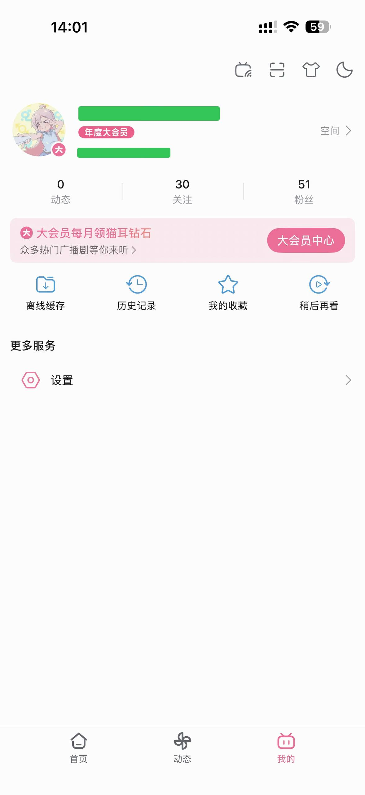
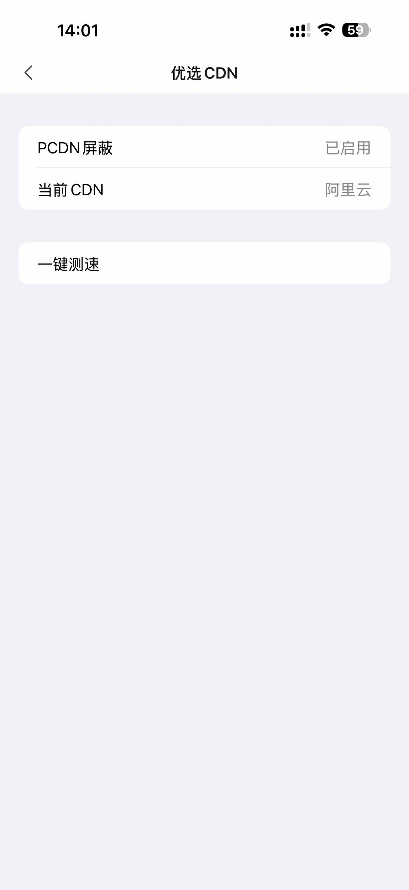

# Bilibili-Clean · 哔哩哔哩净化

面向哔哩哔哩 iOS 的定制版本，整合界面净化、播放辅助、优选 CDN 与空降助手，让浏览和观看更专注。

## 主要功能

七项功能统一位于「我的 → 设置」，空降助手紧随优选 CDN。

| 功能 | 说明 |
|---|---|
| 去广告 | 过滤广告与开屏内容，精简无用功能按钮。 |
| 竖屏模式 | 按使用习惯开启或关闭竖屏模式。 |
| 每日任务 | 打开应用时自动完成每日经验任务。 |
| 默认关注 | 将关注页面的默认栏目设为视频。 |
| 保存视频 | 将已缓存的视频保存到相册。 |
| 优选 CDN | 屏蔽 PCDN，一键测速并手动选择 CDN。 |
| 空降助手 | 根据社区标记跳过赞助、推广、互动提醒和过场等片段。 |

## 安装与更新

当前仓库仅收录项目说明和界面截图，尚未提供源码、IPA 安装包或完整安装教程。

- **安装**：取得对应定制 IPA 后，通过 iOS 签名安装方式安装到 iPhone；签名工具与操作步骤以安装包说明为准。
- **更新**：关注[项目仓库](https://github.com/BABYANYU/Bilibili-Clean)与[发布页面](https://github.com/BABYANYU/Bilibili-Clean/releases)，取得新版 IPA 后按相同方式签名安装。
- **已知适配**：哔哩哔哩 iOS 8.76.0（构建号 87600100）；其他应用版本及最低 iOS 要求尚待确认。

## 界面预览

<table>
  <tr>
    <th align="center">首页</th>
    <th align="center">我的</th>
    <th align="center">七项功能入口</th>
  </tr>
  <tr>
    <td align="center" valign="top"></td>
    <td align="center" valign="top"></td>
    <td align="center" valign="top"></td>
  </tr>
</table>

<table>
  <tr>
    <th align="center">优选 CDN</th>
    <th align="center">空降助手</th>
  </tr>
  <tr>
    <td align="center" valign="top"></td>
    <td align="center" valign="top"></td>
  </tr>
</table>

## 使用与反馈

空降助手支持最短片段时长、跳过提示、进度条颜色及跳过次数与节省时间统计；各类片段可分别设置为总是跳过、跳过一次、手动跳过、仅显示或禁用。整段标签和精彩时刻另有处理规则，具体以插件设置为准。

遇到问题可提交 [Issue](https://github.com/BABYANYU/Bilibili-Clean/issues)，附上应用版本、iOS 版本和复现步骤。

## 许可

本仓库许可见 [MIT License](LICENSE)。空降助手组件与数据的来源及适用条款见 [第三方来源与许可](THIRD_PARTY_NOTICES.md)。
